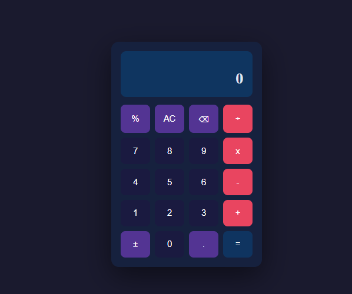

# Calculadora

Projeto de calculadora desenvolvido com **React**, **TypeScript** e **Vite** para praticar a criação de interfaces, gerenciamento de estado e operações matemáticas.

## Visão geral



## Tecnologias utilizadas

- React
- TypeScript
- Vite
- CSS

## Funcionalidades

- Adição, subtração, multiplicação e divisão
- Porcentagem
- Troca de sinal
- Números decimais
- Apagar o último dígito
- Limpar todos os valores
- Exibição da expressão e do resultado atual
- Tratamento básico de divisão por zero

## Como executar o projeto

1. Clone o repositório:

```bash
git clone https://github.com/alantbarboza/react-calculadora
```

2. Acesse a pasta do projeto:

```bash
cd react-calculadora
```

3. Instale as dependências:

```bash
npm install
```

4. Execute o projeto:

```bash
npm run dev
```

5. Acesse o endereço informado no terminal.

## Build

Para gerar a versão de produção:

```bash
npm run build
```

Para visualizar a versão de produção localmente:

```bash
npm run preview
```
